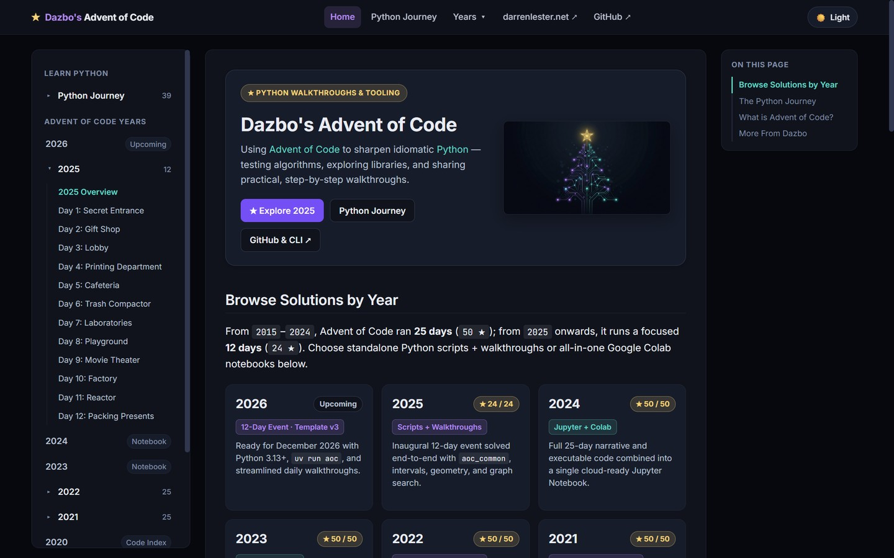

# Dazbo's Advent of Code — Python Solutions & Walkthroughs

**Darren "Dazbo" Lester (`derailed-dash`)** · **[aoc.just2good.co.uk](https://aoc.just2good.co.uk/)** · **[darrenlester.net](https://darrenlester.net)** · **[Dev.to (`dazbo`)](https://dev.to/dazbo)** · **[Medium (`@dazbo`)](https://medium.com/@dazbo)**

[](https://aoc.just2good.co.uk/)

## Why This Repository Exists

I've been using **[Advent of Code](https://adventofcode.com/)** for years to sharpen my **Python** skills — exploring modern standard-library features, benchmarking alternative algorithms, and turning thorny December puzzles into clean, documented code. Every walkthrough pairs runnable Python with plain-English explanations on **[aoc.just2good.co.uk](https://aoc.just2good.co.uk/)**, alongside a 39-chapter **[Python Journey](https://aoc.just2good.co.uk/python/)** curriculum covering reusable patterns, graphs, shortest paths, symbolic maths, and visualisations.

My hope is that this repository and companion site help you:

- Become more fluent and idiomatic in modern Python (`>=3.13`).
- Get unstuck on Advent of Code puzzles without staring at cryptic one-liners.
- Compare practical approaches — standalone `uv`-managed CLI scripts, reusable grid/graph abstractions ([`src/aoc_common/`](src/aoc_common/aoc_commons.py)), and cloud-runnable Jupyter Notebooks.

## Years & Formats at a Glance

| Year | Progress | Format | Site Entry Point |
| :--- | :--- | :--- | :--- |
| **2026** | Upcoming (`12` days) | Python Scripts + Walkthroughs (Template v3) | [2026 Walkthroughs](https://aoc.just2good.co.uk/2026/) |
| **2025** | `12 / 12` (`24 ★`) | Python Scripts + Walkthroughs | [2025 Walkthroughs](https://aoc.just2good.co.uk/2025/) |
| **2024** | `25 / 25` (`50 ★`) | Jupyter Notebook + Google Colab | [2024 Notebook](https://aoc.just2good.co.uk/2024/) |
| **2023** | `25 / 25` (`50 ★`) | Jupyter Notebook + Google Colab | [2023 Notebook](https://aoc.just2good.co.uk/2023/) |
| **2022** | `25 / 25` (`50 ★`) | Python Scripts + Walkthroughs | [2022 Walkthroughs](https://aoc.just2good.co.uk/2022/) |
| **2021** | `25 / 25` (`50 ★`) | Python Scripts + Walkthroughs | [2021 Walkthroughs](https://aoc.just2good.co.uk/2021/) |
| **2020** | `25 / 25` (`50 ★`) | Python Scripts + Source Code Index | [2020 Code Index](https://aoc.just2good.co.uk/2020/) |
| **2018** | `6 / 25` | Python Scripts + Walkthroughs | [2018 Walkthroughs](https://aoc.just2good.co.uk/2018/) |
| **2017** | `12 / 25` | Jupyter Notebook + Google Colab | [2017 Notebook](https://aoc.just2good.co.uk/2017/) |
| **2016** | `25 / 25` (`50 ★`) | Python Scripts + Walkthroughs | [2016 Walkthroughs](https://aoc.just2good.co.uk/2016/) |
| **2015** | `25 / 25` (`50 ★`) | Python Scripts + Walkthroughs | [2015 Walkthroughs](https://aoc.just2good.co.uk/2015/) |

## Use of My Code

This software is shared as open source under the [MIT Licence](LICENSE). If you use parts of it in your own solutions or fork it into your repository, I'd really appreciate an acknowledgement and a link back to this repo, **[aoc.just2good.co.uk](https://aoc.just2good.co.uk/)**, or **[darrenlester.net](https://darrenlester.net)**.

## What is Advent of Code?

Created by Eric Wastl every December since 2015, **[Advent of Code](https://adventofcode.com/about)** releases a two-part programming puzzle each day. Part 1 sets up the challenge; Part 2 almost always scales up the problem until brute-force approaches break and better data structures, memoisation, or algorithms matter. Every past event stays online year-round, and you can solve them in any language you choose.

Traditionally (`2015`–`2024`) AoC ran for 25 days (`50 ★` to save Christmas); from `2025` onwards, the event runs for 12 days (`24 ★`).

## Prerequisites & Setup

To run the solutions in this repository, you'll need the following:

- **Python >=3.13**
- **[`uv`](https://docs.astral.sh/uv/)**: Manages the virtual environment, Python runtime, and lockfile dependencies (`pyproject.toml` / `uv.lock`).
- **Jupyter**: Installed via `--extra jupyter` for running the notebook-based solutions (`.ipynb` files).
- **Legacy (`2015`–`2024`) Dependencies**: Historical solutions that still import `dazbo-commons` / `colorama` are supported via `--extra legacy` (included in `make install`).

### Quick Start (Visitors & Learners)

1. **Clone the repository:**
   ```bash
   git clone https://github.com/derailed-dash/Advent-of-Code.git
   cd Advent-of-Code
   ```

2. **Create a virtual environment and install dependencies:**
   ```bash
   # Install project, dev tooling, Jupyter, and legacy (2015-2024) dependencies
   make install   # runs: uv sync --dev --extra jupyter --extra legacy
   ```

3. **Run solutions on built-in sample inputs (out of the box — no AoC session cookie or decryption key needed):**
   - **Repository CLI (`aoc`):**
     ```bash
     uv run aoc list                       # Overview of all years, day counts, and Standalone/Jupyter format
     uv run aoc list 2025                  # Inspect day scripts and sample/real input readiness for one year
     uv run aoc run 2018d07 -s             # Run a Template v3 day in sample-only mode (no input.txt needed)
     uv run aoc run 2026 1 -s              # Template v3 sample-only run (once 2026 is scaffolded)
     uv run aoc new-year 2026 --dry-run    # Preview scaffolding d01..d12 from Template v3
     ```
   - **Python scripts directly:**
     ```bash
     uv run python src/AoC_2025/d01/d01.py
     ```
   - **Jupyter Notebooks:** Open directly in VS Code or launch JupyterLab locally:
     ```bash
     uv run jupyter lab
     ```
   - **Run offline lint, spellcheck, typecheck, and unit tests:**
     ```bash
     make check     # runs codespell, ruff, pyright, and pytest src/tests
     ```

4. **Run with your own Advent of Code inputs (optional):**
   My personal `input.txt` files are encrypted in Git (per [AoC's sharing policy](https://adventofcode.com/about)). To use your own inputs instead:
   ```bash
   cp .env.template .env      # Add your adventofcode.com 'session' cookie to AOC_SESSION_COOKIE
   make clean-inputs          # Remove locked git-crypt input files (leaves samples & unlocked files intact)
   uv run aoc run 2025d01     # Downloads your personal input.txt and runs the solution
   ```
   *(Forking this repo? See [Encrypting AoC Inputs with `git-crypt`](docs/python/encrypting.md).)*

<details>
<summary><strong>Maintainer Multi-Machine Setup (<code>git-crypt</code>)</strong></summary>

This repository uses two [`git-crypt`](.gitattributes) mechanisms so private puzzle inputs and local credentials stay encrypted on GitHub:

1. **Direct filter (`input*.txt filter=git-crypt`)**: Puzzle inputs (`src/AoC_YYYY/dNN/input/input*.txt`) are tracked directly in Git and transparently decrypted in the working tree once unlocked.
2. **Parallel `.enc` twins (`*.enc filter=git-crypt`)**: Local secrets and workspace skills (`.env`, `docs/.env`, `.agents/skills/*/SKILL.md`) stay gitignored in plaintext and synchronise via encrypted `.enc` twins managed by `git-crypt-helper.sh`.

On a new machine (**never** run `git-crypt init`, which mints an incompatible key):

1. `git-crypt unlock ~/localdev/git-crypt-key`
2. `git-crypt-helper.sh sync-from-enc`
3. `make sync-secrets`

Whenever you update `.env`, `docs/.env`, or `.agents/skills/*/SKILL.md`, re-encrypt its twin with `git-crypt-helper.sh sync-to-enc <file>` before committing. See [`docs/python/encrypting.md`](docs/python/encrypting.md) for the full `git-crypt` guide.

</details>

## Using the `aoc` CLI

[`pyproject.toml`](pyproject.toml) exposes `[project.scripts] aoc = "aoc_common.cli:main"`, implemented in [`src/aoc_common/cli.py`](src/aoc_common/cli.py). Invoke it from the repository root with `uv run aoc <subcommand> ...` (add `--no-sync` after `uv run` for instant startup once `.venv` is synced via `make install`).

### Subcommands & Parameters

| Command | Parameters & Flags | Purpose |
| :--- | :--- | :--- |
| Global | `--root PATH` | Override auto-detected repository root (useful in scripts or tests) |
| `aoc list` | `[YEAR]` `--json` | List every `AoC_YYYY` year with `Completed/Total` progress (`e.g. 25/25, 12/25, 12/12`) and solution format (`Standalone (.py)`, `Jupyter (.ipynb)`, or `Both`), or inspect `dNN` solved status, scripts, and boolean input/sample readiness for one `YEAR` (terminal output adds clickable OSC 8 hyperlinks on `Year` and `Day` columns pointing to the AoC event and problem pages; never reads input file contents) |
| `aoc fetch` | `<TARGET> [DAY]` (`1`, `01`, `d01`, `20251`, `202501`, `2025d01`, or `2025 1`) `--desc-only \| --input-only` `--write-sample` `--sample-part {1,2}` `--sample-index N` `--force` `--dry-run` `--json` | Fetch the AoC problem page in memory (no temporary `desc.html`), rank `<pre><code>` sample candidates, optionally populate `input/sample_input_part_N.txt` via heuristic or `--sample-index` (overwriting 0-byte placeholders safely), and cache `input/input.txt` without exposing raw input data |
| `aoc run` | `<TARGET> [DAY]` (`1`, `01`, `d01`, `20251`, `202501`, `2025d01`, or `2025 1`) `-p/--part {1,2,all}` `-s/--sample-only` `--no-samples` `-d/--debug` `--json` `--script FILENAME` | Execute a puzzle script; runs Template v3 scripts in-process via [`run_puzzle`](src/aoc_common/runner.py) and legacy scripts via subprocess (when only a day is passed, picks `AOC_YEAR`, else current year if `src/AoC_<year>` exists, else latest existing `AoC_YYYY`; auto-resolves single scripts in historical `dNN_<slug>` folders or prompts with `--script` when multiple variants exist) |
| `aoc new-year` | `<YEAR>` `--days N` (1–25, default `12`) `--dry-run` `--force` `--json` | Scaffold `src/AoC_<YEAR>/d01..d<days>` from Template v3 without overwriting existing scripts (unless `--force`) and without creating empty `input.txt` files |
| `aoc clean-inputs` | `--dry-run` `--json` | Delete locked `git-crypt` `input*.txt` blobs under `src/` so public cloners can fetch their own AoC inputs (leaves samples and unlocked files untouched) |

Individual Template v3 day scripts (such as [`src/template_folder/template.py`](src/template_folder/template.py)) also accept the same `-p/--part`, `-s/--sample-only`, `--no-samples`, `-d/--debug`, and `--json` flags directly via `uv run python ...` (`-s` and `--no-samples` are mutually exclusive; `--json` emits clean JSON on `stdout` and routes Rich logs to `stderr`).

### `Makefile` Targets

[`Makefile`](Makefile) wraps the `aoc` CLI, offline quality checks, `git-crypt` status checks, and local Jekyll previews:

| Target / Script | Underlying Command | Example / Notes |
| :--- | :--- | :--- |
| `make help` | Built-in target help | `make` or `make help` |
| `make install` | `uv sync --dev --extra jupyter --extra legacy` | Installs core, dev, Jupyter, and legacy `2015`–`2024` extras |
| `make list` | `uv run aoc list ...` | `make list`, `make list 2025`, or `make list YEAR=2025` |
| `make fetch` | `uv run aoc fetch ...` | `make fetch 202501`, `make fetch 2018d07`, `make fetch TARGET=2018d07`, or `make fetch 1 ARGS="--write-sample --desc-only"` |
| `make run` | `uv run aoc run ...` | `make run 1`, `make run 2018d07`, `make run TARGET=2018d07`, or `make run YEAR=2026 DAY=1 ARGS="-s -d"` *(pass runner flags via `ARGS="..."` because `make` intercepts bare `-s`/`-d`)* |
| `make new-year` | `uv run aoc new-year ...` | `make new-year 2026` or `make new-year YEAR=2026 DAYS=25` *(defaults to `12` days for 2025+)* |
| [`scripts/create_year.sh`](scripts/create_year.sh) | Standalone Bash fallback (`sed` scaffold) | `./scripts/create_year.sh 2026` |
| `make lint` | `codespell -s`, `ruff check`, `pyright` | Read-only offline checks on active code and docs |
| `make fix` | `codespell -w`, `ruff check --fix`, `ruff format` | Auto-fixes active modules (`src/aoc_common`, `src/tests`, `src/template_folder`) |
| `make test` | `uv run pytest src/tests` | Offline unit test suite |
| `make check` | `make lint` + `make test` | Full offline verification gate |
| `make sync-secrets` | `git-crypt-helper.sh status` | Shows parallel `.enc` secret sync status (or `git-crypt status -e`) |
| `make docs` | `cd docs && docker compose up` | Serves local Jekyll preview at `http://127.0.0.1:4000` |
| `make docs-build` | `cd docs && docker compose build` | Rebuilds Docker image after editing `docs/Dockerfile` or `docs/Gemfile` |
| `make docs-stop` | `cd docs && docker compose down` | Stops and removes the local Jekyll container |
| `make clean-inputs` | `uv run aoc clean-inputs ...` | `make clean-inputs` or `make clean-inputs ARGS="--dry-run"` *(removes locked `git-crypt` `input*.txt` blobs only)* |
| `make clean` | Cache cleanup | Removes `.pytest_cache`, `.ruff_cache`, `__pycache__`, and `docs/_site` |

## Daily AoC Workflow

A typical day follows a quick sample-first loop from scaffolding through walkthrough publication:

1. **Scaffold the year** (once per event):
   ```bash
   make new-year YEAR=2026       # defaults to 12 days for 2025+; pass DAYS=25 for legacy years
   ```
2. **Ensure `AOC_SESSION_COOKIE` is configured**: Copy [`.env.template`](.env.template) to `.env` and paste your `session` cookie (or restore via `git-crypt-helper.sh sync-from-enc`; maintainers re-encrypt updates with `git-crypt-helper.sh sync-to-enc .env`).
3. **Fetch the puzzle and sample inputs**:
   ```bash
   make fetch 2026d01 ARGS="--write-sample"   # or: uv run aoc fetch 2026d01 --json
   ```
   Verify `input/sample_input_part_1.txt` against the puzzle description, then enter the expected sample answer in `PART1_SAMPLES` in the day's script.
4. **Iterate sample-first, solve, and verify**:
   ```bash
   make run 2026d01 ARGS="-s -d"  # Part 1/2 against sample inputs with debug logging
   make run 2026d01               # Run against real input/input.txt (repeat for Part 2)
   make check                     # Confirm codespell, ruff, pyright, and pytest pass
   ```
5. **Author and preview the walkthrough**: Create `docs/2026/1.md` (adding `mathjax: true` to frontmatter if using LaTeX maths), register the entry in [`docs/_data/navigation.yaml`](docs/_data/navigation.yaml) (and `docs/2026/index.md` where manual tables are used), preview locally at `http://127.0.0.1:4000` via `make docs`, and stop the server with `make docs-stop`. *(When using an AI coding agent in this repo, the `.agents/skills/` suite — `aoc-problem-summary`, `aoc-solution-support`, `aoc-create-doc`, and `aoc-megathread-post` — automates these steps.)*

## Structure and Solution Approaches

This repository is organised by year and solution type. I've taken two main approaches for my solutions:

### 1. Python Scripts with Separate Walkthroughs

For most years (e.g. 2015–2022, 2025+), the solutions are Python scripts accompanied by detailed Markdown walkthroughs published at [aoc.just2good.co.uk](https://aoc.just2good.co.uk/).

- **Code**: Solution scripts (`.py`) live under `src/AoC_YYYY/dNN/`.
- **Walkthroughs**: Companion Markdown files (`.md`) live under `docs/YYYY/`, built with Jekyll.

### 2. Jupyter Notebooks

For some years (e.g. 2023–2024), solutions use Jupyter Notebooks combining Python code and narrative walkthroughs in a single `.ipynb` file inside `src/AoC_YYYY/`.

### Directory Structure

| Path | Purpose |
| :--- | :--- |
| [`docs/`](docs/index.md) | Jekyll source for [aoc.just2good.co.uk](https://aoc.just2good.co.uk/) (`Midnight AoC` custom theme in [`docs/DESIGN.md`](docs/DESIGN.md), `docs/YYYY/` walkthroughs, `docs/python/` guides, `_config.yml`, `docker-compose.yml`) |
| `src/AoC_YYYY/` | Solution folders (`d01/`..`d12/` from 2025+, `d01/`..`d25/` for 2015–2024), or `.ipynb` notebooks |
| [`src/aoc_common/`](src/aoc_common/aoc_commons.py) | Shared utility package (`aoc_commons.py`, `runner.py`, `cli.py`: `Locations`, `get_aoc_locations`, `run_puzzle`, `Point`, `Point3D`, `Grid`, algorithms, Rich logging) |
| [`src/template_folder/`](src/template_folder/template.py) | Starter Python script and Jupyter notebook templates (Template v3) |
| [`src/tests/`](src/tests/test_aoc_commons.py) | Offline `pytest` / `unittest` suite for `aoc_common`, `runner`, and `aoc` CLI |
| [`scripts/`](scripts/create_year.sh) | Helper scripts such as [`create_year.sh`](scripts/create_year.sh) |
| [`.github/workflows/`](.github/workflows/pr-checks.yml) | CI checks (`pr-checks.yml`) and Gemini PR/issue workflows |
| [`.agents/rules/`](.agents/rules/aoc-retrieval.md) | Model-triggered AoC retrieval rule ([`aoc-retrieval.md`](.agents/rules/aoc-retrieval.md)) |
| `.agents/skills/` | Workspace AoC skills (`aoc-problem-summary`, `aoc-solution-support`, `aoc-create-doc`, `aoc-megathread-post`; `SKILL.md.enc` encrypted with `git-crypt`) |
| [`Makefile`](Makefile) | Common targets (`install`, `lint`, `fix`, `test`, `check`, `list`, `fetch`, `run`, `new-year`, `docs`, `docs-build`, `docs-stop`, `clean-inputs`, `clean`, `sync-secrets`) |
| [`pyproject.toml`](pyproject.toml) | Project metadata, dependencies, `ruff`, `codespell`, and `pyright` configuration |
| [`.env.template`](.env.template) | Template environment variables (`PYTHONPATH=src`, `AOC_SESSION_COOKIE`) |
| [`AGENTS.md`](AGENTS.md) | Repository guide for coding agents and automated reviewers |
| [`TODO.md`](TODO.md) | Project roadmap and improvement backlog |

### Helper Libraries

Shared utilities live in [`src/aoc_common/aoc_commons.py`](src/aoc_common/aoc_commons.py) and have **zero dependency on `dazbo-commons`**. Because [`pyproject.toml`](pyproject.toml) includes a `[build-system]` packaging `src/aoc_common` editably into `.venv`, both standalone Python scripts and local Jupyter notebooks import `import aoc_common.aoc_commons as ac` directly without setting `PYTHONPATH=src` (and cloud notebooks such as Google Colab install `aoc_common` straight from GitHub):

- **Logging & Output**: `setup_logging` (configured with `RichHandler`, `force=True`, and `stderr=True` support for `--json` mode), `setup_file_logging`, and `top_and_tail`.
- **Paths & Input Retrieval**: `Locations`, `get_aoc_locations` (safe in both scripts via `__file__` and Jupyter/Colab notebooks without `__file__`), `get_locations`, `get_aoc_session_cookie`, `is_git_crypt_locked`, `write_puzzle_input_file` (with AoC `User-Agent` header enforcement and automatic replacement of locked `git-crypt` blobs), and in-memory HTML/sample parsers `fetch_puzzle_page` and `parse_puzzle_html`.
- **Runner, Testing & Timing**: `run_puzzle` (`Rich` + `argparse` Template v3 CLI orchestration), `check_samples` (raises `AssertionError` cleanly without `sys.exit`), `validate`, `format_duration`, and the `timer` context manager.
- **2D/3D Geometry & Algorithms**: `Point`, `Point3D`, `Vectors`, `VectorDicts`, and `Grid` classes, sparse point-cloud helpers (`bounding_box`, `render_points`), plus `binary_search`, `lower_bound`, `upper_bound`, `merge_intervals`, `get_factors`, and `to_base_n`.

#### History: From `dazbo-commons` (`dc`) to `aoc_common` (`ac`)

1. **2021–2022 (`dazbo-commons` on PyPI)**: Published [`dazbo-commons-py`](https://github.com/derailed-dash/dazbo-commons-py) as a general-purpose PyPI utility package providing `colorama`-based `ColouredFormatter` / `retrieve_console_logger`, `Locations` / `get_locations`, `top_and_tail`, and `.env` loading (`get_envs_from_file`).
2. **May–Sep 2023 (`type_defs.py` → `aoc_commons.py`)**: Extracted AoC-specific helpers (`Point`, `Vectors`, `Grid`, `binary_search`, `merge_intervals`, `to_base_n`) into an in-repo `type_defs` module, renamed it to `aoc_commons.py`, and briefly trialled PyPI packaging before keeping it inside this repository.
3. **May 2024–Oct 2025 (Dual `dc` + `ac` era)**: Scripts and the 2024 notebook imported both `dazbo_commons as dc` (for general logging, `Locations`, and `top_and_tail`) and `aoc_common.aoc_commons as ac` (for AoC geometry and puzzle retrieval).
4. **Dec 2025–2026 (Consolidated `ac` + `Rich`)**: Replaced `colorama` logging with `Rich` (`RichHandler`), consolidated `Locations`, `load_dotenv()`, and `top_and_tail` back into `aoc_common`, enabled editable packaging in `pyproject.toml` so scripts and notebooks share a single import path, and moved `dazbo-commons` and `colorama` into `[project.optional-dependencies] legacy` solely so untouched `2015`–`2024` solutions remain runnable.

### Assertions and Testing

Each solution validates sample inputs via `aoc_common.validate` (raising `AssertionError` on mismatch), while `aoc_common` itself is tested offline via:

```bash
uv run pytest src/tests
```

## Documentation Website

This repository includes a companion static website featuring walkthroughs, the **Python Journey** curriculum, and a custom **Midnight AoC** dark-first theme with persisted Daylight Light toggle (specified in [`docs/DESIGN.md`](docs/DESIGN.md)).

- **Website URL**: [https://aoc.just2good.co.uk/](https://aoc.just2good.co.uk/)
- **Technology**: Static site built with [Jekyll](https://jekyllrb.com/) using custom `_layouts/`, `_sass/` partials, and [`docs/assets/js/site.js`](docs/assets/js/site.js)
- **Source & Authoring Guide**: [`docs/`](docs/index.md) and [`docs/readme.md`](docs/readme.md)
- **CI Build Check**: [`.github/workflows/pr-checks.yml`](.github/workflows/pr-checks.yml) runs `bundle exec jekyll build --trace` on pull requests and pushes

### Working with the Documentation Locally

You can build and serve the documentation website locally using Docker:

```bash
make docs         # runs: cd docs && docker compose up
make docs-build   # rebuild image after editing docs/Dockerfile or docs/Gemfile
make docs-stop    # stop and remove the container
```

The site will be available at `http://127.0.0.1:4000`. If you need to supply `JEKYLL_GITHUB_TOKEN`, restore `docs/.env` via `git-crypt-helper.sh sync-from-enc` (check sync status with `make sync-secrets`) or copy [`docs/.env.template`](docs/.env.template) to `docs/.env`.
